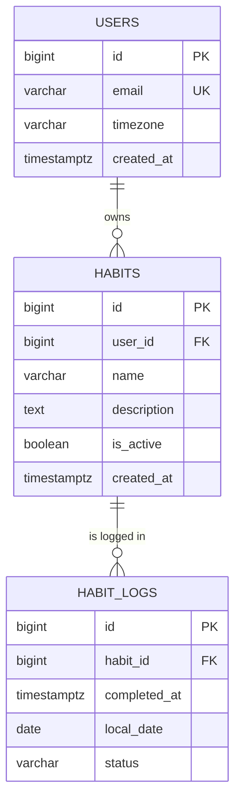

# Habit Tracker


A habit tracking backend built with **Java 21 and Spring Boot**. Users define habits and log their progress day by day, with each day computed in the **user's own time zone**.

This is a learning project: the goal is to build a solid foundation in Spring Boot (persistence, migrations, testing, layered design) by implementing each layer deliberately and testing it against a real database.

> **Status:** work in progress. The persistence layer is complete and tested. The service layer and the REST API are next (see the [roadmap](#roadmap)).

## Tech stack

| Area | Technology |
|---|---|
| Language | Java 21 (virtual threads enabled) |
| Framework | Spring Boot 4.1 (Spring MVC, Spring Data JPA, Bean Validation) |
| Database | PostgreSQL 16 |
| Migrations | Flyway |
| Testing | JUnit 5, `@DataJpaTest`, Spring Boot test starters |
| Build | Maven (wrapper included) |
| Local infra | Docker Compose |

## Data model



Key design decisions:

- **Time-zone aware days.** A log stores both the exact moment (`completed_at`, a `timestamptz`) and the user's calendar day (`local_date`). The same instant can be "today" for one user and "tomorrow" for another, so the day is derived from the user's `timezone`.
- **One log per habit per day**, enforced by the database with a unique constraint on `(habit_id, local_date)`, not only in application code. This protects against race conditions between concurrent requests.
- **Schema owned by Flyway, only validated by Hibernate** (`ddl-auto: validate`). If an entity and the schema drift apart, the application refuses to start.
- **Cascade deletes at database level**: deleting a user removes their habits, and deleting a habit removes its logs.
- **Lazy relationships** (`@ManyToOne(fetch = LAZY)`) to avoid loading related entities that are never used.

## Project structure

```
src/main/java/habits/app
├── domain        # JPA entities: User, Habit, HabitLog
└── repository    # Spring Data JPA repositories and derived queries

src/main/resources
├── application.yml
└── db/migration  # Flyway migrations (V1__initial_schema.sql)

src/test/java/habits/app   # Repository integration tests
```

## Getting started

### Prerequisites

- Java 21
- Docker and Docker Compose

### Run it

```bash
# 1. Start PostgreSQL
docker compose up -d

# 2. Run the application (Flyway applies the migrations on startup)
./mvnw spring-boot:run
```

The database settings live in `src/main/resources/application.yml` and match the `docker-compose.yml` file. The credentials in this repository are for **local development only**.

> The REST API is not implemented yet. For now the application exposes only a placeholder endpoint at `/`.

### Run the tests

```bash
docker compose up -d   # tests use the same local PostgreSQL
./mvnw test
```

## Testing approach

The repository tests are integration tests that run against **a real PostgreSQL** instead of an in-memory database, so they exercise the same types, constraints and behavior as the application (`@DataJpaTest` with the embedded database replacement disabled). Each test runs in a transaction that is rolled back afterwards, so tests are independent of each other.

What they cover:

- **Persistence round trips.** Entities are saved, flushed and the persistence context is cleared before reading them back, so the data really comes from the database and not from Hibernate's first-level cache.
- **Derived queries**, such as finding a user by email, listing a user's active habits and fetching a habit's logs between two dates (including boundary dates and ordering).
- **Existence checks** by habit and date.
- **Database constraints**: duplicate emails and duplicate logs for the same habit and day are rejected with `DataIntegrityViolationException`, while the same day for different habits is allowed.

## Roadmap

- [x] Database schema and Flyway migrations
- [x] JPA entities
- [x] Repositories with derived queries
- [x] Repository integration tests against PostgreSQL
- [x] Service layer: business rules, transactions and unit tests with Mockito
  - [ ] User registration (unique email)
  - [ ] Habit creation
  - [ ] Log a habit for "today" in the user's time zone
- [ ] REST API with DTOs and request validation
- [ ] Global error handling (`@RestControllerAdvice`)
- [ ] API documentation (OpenAPI)
- [ ] Dockerfile and CI pipeline

## Author

Built by [@saulcone](https://github.com/saulcone).
