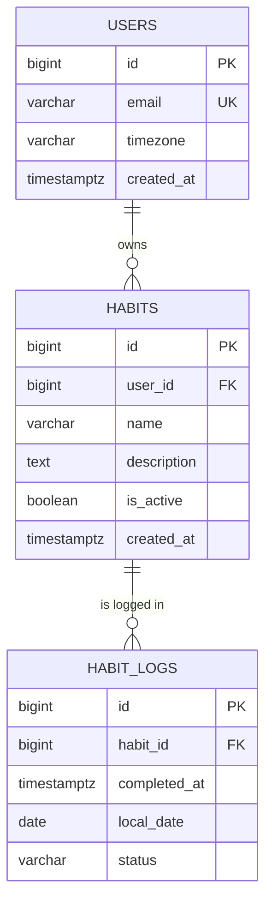

# Habit Tracker


A habit tracking backend built with **Java 21 and Spring Boot**. Users define habits and log their progress day by day, with each day computed in the **user's own time zone**.

This is a learning project: the goal is to build a solid foundation in Spring Boot (persistence, migrations, services, REST API, testing, layered design) by implementing each layer deliberately and testing it.

> **Status:** the persistence layer, the service layer and the REST API (5 endpoints) are complete and tested. Remaining work: API documentation and CI (see the [roadmap](#roadmap)).

## Tech stack

| Area | Technology |
|---|---|
| Language | Java 21 (virtual threads enabled) |
| Framework | Spring Boot 4.1 (Spring MVC, Spring Data JPA, Bean Validation) |
| Database | PostgreSQL 16 |
| Migrations | Flyway |
| Testing | JUnit 5, Mockito, `@DataJpaTest`, `@WebMvcTest`, MockMvc |
| Build | Maven (wrapper included) |
| Local infra | Docker Compose |

## Data model



Key design decisions:

- **Time-zone aware days.** A log stores both the exact moment (`completed_at`, a `timestamptz`) and the user's calendar day (`local_date`). The same instant can be "today" for one user and "tomorrow" for another, so the day is derived from the user's `timezone`.
- **One log per habit per day**, enforced by the database with a unique constraint on `(habit_id, local_date)`, not only in application code. This protects against race conditions between concurrent requests.
- **One habit name per user**, also enforced by a unique constraint on `(user_id, name)`.
- **Schema owned by Flyway, only validated by Hibernate** (`ddl-auto: validate`). If an entity and the schema drift apart, the application refuses to start.
- **Cascade deletes at database level**: deleting a user removes their habits, and deleting a habit removes its logs.
- **Lazy relationships** (`@ManyToOne(fetch = LAZY)`) to avoid loading related entities that are never used.

## API

Base path: `/api/v1`. Requests and responses are JSON.

| Method | Path | Description | Success | Errors |
|---|---|---|---|---|
| `POST` | `/users` | Register a user (email + IANA time zone) | `201` | `400`, `409` |
| `POST` | `/users/{userId}/habits` | Create a habit for a user | `201` | `400`, `404`, `409` |
| `GET` | `/users/{userId}/habits` | List the user's active habits, ordered by name | `200` | `400`, `404` |
| `POST` | `/habits/{habitId}/logs` | Log the habit for "today" in the user's time zone | `201` new, `200` already logged | `400`, `404`, `409` |
| `GET` | `/habits/{habitId}/logs?begin=YYYY-MM-DD&end=YYYY-MM-DD` | List a habit's logs between two dates (inclusive), ordered by date | `200` | `400`, `404` |

**Logging is idempotent per day.** Calling `POST /habits/{habitId}/logs` twice on the same local day returns the existing log with `200` instead of an error. The first call returns `201`.

### Example

```bash
# Register a user
curl -i -X POST http://localhost:8080/api/v1/users \
  -H "Content-Type: application/json" \
  -d '{"email":"user@example.com","timezone":"Europe/Madrid"}'

# Create a habit
curl -i -X POST http://localhost:8080/api/v1/users/1/habits \
  -H "Content-Type: application/json" \
  -d '{"name":"Read","description":"30 minutes a day"}'

# Log it for today (201 the first time, 200 afterwards)
curl -i -X POST http://localhost:8080/api/v1/habits/1/logs

# Logs for a date range
curl -i "http://localhost:8080/api/v1/habits/1/logs?begin=2026-11-01&end=2026-11-30"
```

### Error handling

All errors use the standard **Problem Details** format (RFC 9457, `application/problem+json`) with a human-readable `detail`:

```json
{
  "detail": "Habit's name already existing.",
  "instance": "/api/v1/users/1/habits",
  "status": 409,
  "title": "Conflict"
}
```

| Status | When |
|---|---|
| `400` | Invalid input: failed validation, malformed JSON, invalid time zone, non-numeric ids, missing or badly formatted parameters, `begin` after `end` |
| `404` | The user or the habit does not exist |
| `409` | Conflict with the current state: email already registered, habit name already used by that user, inactive habit, a log already created concurrently for that day |
| `500` | Anything unexpected. The response carries a **generic message only**: internal details (SQL, stack traces, constraint names) are logged on the server and never sent to the client |

Database unique constraints are translated into business errors (`409`) by the service layer; any other integrity violation is rethrown and ends up as a `500`.

## Project structure

```
src/main/java/habits/app
├── api
│   ├── controller   # REST controllers and the global exception handler
│   └── dto          # Request/response records (validation on input DTOs)
├── service          # Business rules, transactions
├── exception        # Business exceptions
├── domain           # JPA entities: User, Habit, HabitLog
└── repository       # Spring Data JPA repositories and derived queries

src/main/resources
├── application.yml
└── db/migration     # Flyway migrations

src/test/java/habits/app
├── repository       # @DataJpaTest integration tests against PostgreSQL
├── service          # Unit tests with Mockito
└── api/controller   # @WebMvcTest tests with MockMvc
```

Layering rules: controllers are thin and only deal with HTTP and DTO mapping; services know nothing about HTTP (they return domain objects or throw business exceptions); the global `@RestControllerAdvice` maps exceptions to status codes in a single place.

## Getting started

### Prerequisites

- Java 21
- Docker and Docker Compose

### Run it

```bash
# 1. Start PostgreSQL
docker compose up -d

# 2. Run the application (Flyway applies the migrations on startup)
./mvnw spring-boot:run
```

The API is then available at `http://localhost:8080/api/v1`. The database settings live in `src/main/resources/application.yml` and match the `docker-compose.yml` file. The credentials in this repository are for **local development only**.

### Run the tests

```bash
docker compose up -d   # the repository tests use the same local PostgreSQL
./mvnw test
```

## Testing approach

The project has three kinds of tests, one per layer:

- **Repository tests** (`@DataJpaTest`) run against **a real PostgreSQL** instead of an in-memory database, so they exercise the same types, constraints and behavior as the application. Each test runs in a transaction that is rolled back afterwards. They cover persistence round trips (flushing and clearing the persistence context before reading back), derived queries (including boundary dates and ordering), existence checks and database constraints.
- **Service tests** (Mockito) check the business rules in isolation: validation order, idempotent logging, translation of constraint violations into business exceptions, and that no repository is touched when a cheap local check already fails. Time is injected through a `Clock`, so tests use a fixed instant and check the same moment in different time zones (for example, 23:30 UTC is already the next day in Madrid but still the same day in Los Angeles).
- **Controller tests** (`@WebMvcTest` + MockMvc) check the HTTP contract with the service mocked: status codes, JSON bodies, validation errors, malformed input, and that internal error messages never reach the client.

## Roadmap

- [x] Database schema and Flyway migrations
- [x] JPA entities
- [x] Repositories with derived queries
- [x] Repository integration tests against PostgreSQL
- [x] Service layer: business rules, transactions and unit tests with Mockito
    - [x] User registration (unique email)
    - [x] Habit creation
    - [x] Log a habit for "today" in the user's time zone
- [x] REST API with DTOs and request validation
- [x] Global error handling (`@RestControllerAdvice`)
- [x] Read endpoints (active habits, logs between two dates)
- [ ] API documentation (OpenAPI / Swagger UI)
- [X] Dockerfile and CI pipeline (GitHub Actions)

Out of scope for now: authentication, CORS and a front end.

## Author

Built by [@saulcone](https://github.com/saulcone).